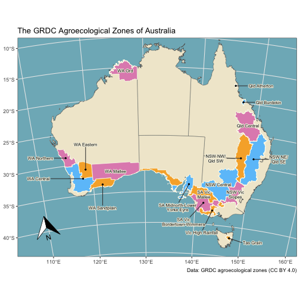

# GRDC Agroecozones



This repository contains geospatial data files that contain the GRDC's agroecozone classifications in EPSG:4326 (unprojected) as:

- [geopackage (.gpkg) file](https://github.com/AAGI-AUS/GRDC_AEZ/raw/refs/heads/main/aez.gpkg),
- [shapefile](https://github.com/AAGI-AUS/GRDC_AEZ/raw/refs/heads/main/shapefile.zip), and
- [native R .Rds](https://github.com/AAGI-AUS/GRDC_AEZ/raw/refs/heads/main/aez.Rds) file providing an {sf} object with the AEZ and Region fields as a `factor`.

## Changes to the original data set

This dataset has had the geometries repaired and corrected.

This dataset also contains a "Region" field that contains "Northern", "Southern" or "Western" denoting the GRDC region that the AEZ falls in for a higher-level aggregation than the original data set did.


``` r
aez <- readRDS("aez.Rds")
summary(aez)
```

```
##              AEZ                geom         Region    colour_id
##  NSW Central   : 1   MULTIPOLYGON :18   Northern:7   Min.   :1  
##  NSW NE/Qld SE : 1   epsg:9473    : 0   Southern:5   1st Qu.:1  
##  NSW NW/Qld SW : 1   +proj=aea ...: 0   Western :6   Median :2  
##  NSW Vic Slopes: 1                                   Mean   :2  
##  Qld Atherton  : 1                                   3rd Qu.:3  
##  Qld Burdekin  : 1                                   Max.   :3  
##  (Other)       :12
```

``` r
unique(aez$AEZ)
```

```
##  [1] NSW Central                  NSW NE/Qld SE               
##  [3] NSW NW/Qld SW                NSW Vic Slopes              
##  [5] Qld Atherton                 Qld Burdekin                
##  [7] Qld Central                  SA Midnorth-Lower Yorke Eyre
##  [9] SA Vic Bordertown-Wimmera    SA Vic Mallee               
## [11] Tas Grain                    Vic High Rainfall           
## [13] WA Central                   WA Eastern                  
## [15] WA Mallee                    WA Northern                 
## [17] WA Ord                       WA Sandplain                
## 18 Levels: NSW Central NSW NE/Qld SE NSW NW/Qld SW ... WA Sandplain
```

## Licence

CC-BY

[Creative Commons Attribution 4.0 International licence](http://creativecommons.org/licenses/by/4.0/)

See: <https://data.grdc.com.au/item/6798/dataset/australian-statistical-geography-standard> for more details.
